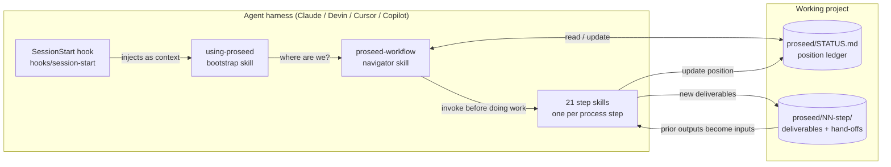
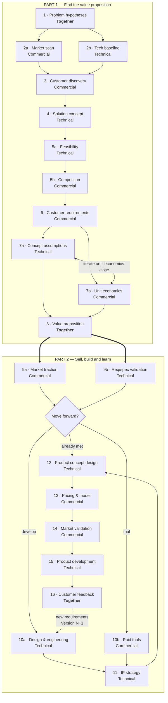
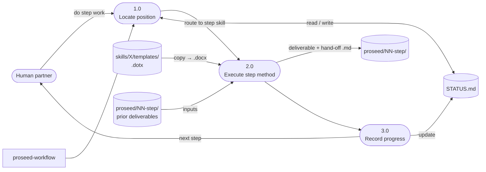

```text
██████╗ ██████╗  ██████╗ ███████╗███████╗███████╗██████╗
██╔══██╗██╔══██╗██╔═══██╗██╔════╝██╔════╝██╔════╝██╔══██╗
██████╔╝██████╔╝██║   ██║███████╗█████╗  █████╗  ██║  ██║
██╔═══╝ ██╔══██╗██║   ██║╚════██║██╔══╝  ██╔══╝  ██║  ██║
██║     ██║  ██║╚██████╔╝███████║███████╗███████╗██████╔╝
╚═╝     ╚═╝  ╚═╝ ╚═════╝ ╚══════╝╚══════╝╚══════╝╚═════╝
```

# ProSeed — Hypothesis Validation Plugin

> A 16-step, two-part methodology for industrial innovation — encoded as an agent plugin.
> It takes a deep-tech idea from problem hypotheses to a validated value proposition,
> then through selling, building, and learning.


`hypothesis-validation` · `industrial-innovation` · `deep-tech` · `customer-discovery` · `value-proposition` · `unit-economics` · `commercialization` · `agent-workflow`

---

## Overview

ProSeed turns a validation methodology into an **enforced workflow**. Instead of hoping an
agent follows the process, the plugin injects the process rules at session start, keeps
project position in a `STATUS.md` ledger, and routes every piece of work through the skill
for the step you're actually on.

Architecture is modeled on [obra/superpowers](https://github.com/obra/superpowers):
a session-start hook injects a bootstrap skill, and every step of the methodology is a
skill the agent must invoke before doing the work.

**Two kinds of output per step:**

- **`.docx` deliverables** — the human-facing documents (from `.dotx` templates where provided), with sign-off and a per-hypothesis micro-gate: *Go to next step / Rework / Drop*.
- **A canonical `.md` hand-off** — the machine-readable summary the next step consumes (`feasibility-report.md`, `customer-requirements.md`, `decision-gate.md`, …).

## How It Works



1. At session start, `hooks/session-start` emits the full `using-proseed` skill as
   `additionalContext`, establishing the rule: **invoke the step's skill before doing the
   step's work** — including desk research, drafting, or analysis.
2. `proseed-workflow` is the navigator: it locates the current step (via
   `proseed/STATUS.md`), routes to the right step skill, and enforces the parallel
   branches, the 7a↔7b iteration loop, the decision gate, and the Step-16 version loop.
3. Each step skill defines purpose, inputs (prior deliverables), method, deliverable path,
   red-flag rationalizations, and the next skill to invoke.

## The Process



### Step → Skill → Deliverable

| # | Step | Owner | Skill | Hand-off artifact |
|---|------|-------|-------|-------------------|
| 1 | Problem hypotheses | Together | `proseed:problem-hypotheses` | `01-problem-hypotheses/` → `problem-hypotheses.md` + per-hypothesis `.docx` |
| 2a | Market scan | Commercial | `proseed:market-scan` | `02a-market-scan/` → `market-scan.md` + per-hypothesis `.docx` |
| 2b | Tech baseline | Technical | `proseed:tech-baseline` | `02b-tech-baseline/` → `tech-baseline.md` + per-hypothesis `.docx` |
| 3 | Customer discovery | Commercial | `proseed:customer-discovery` | `03-customer-discovery/` → `discovery-synthesis.md` + transcripts |
| 4 | Solution concept | Technical | `proseed:solution-concept` | `04-concept/concept-one-pager.md` |
| 5a | Feasibility | Technical | `proseed:feasibility` | `05a-feasibility/feasibility-report.md` |
| 5b | Competition | Commercial | `proseed:competition` | `05b-competition/` → map + `competition-summary.md` |
| 6 | Customer requirements | Commercial | `proseed:customer-requirements` | `06-customer-requirements/customer-requirements.md` |
| 7a | Concept assumptions | Technical | `proseed:concept-assumptions` | `07a-concept-assumptions/` → assumptions + roadmap |
| 7b | Unit economics | Commercial | `proseed:unit-economics` | `07b-unit-economics/` → model + `unit-economics-summary.md` |
| 8 | Value proposition | Together | `proseed:value-proposition` | `08-value-proposition/value-proposition-onepager.md` |
| 9a | Market traction | Commercial | `proseed:market-traction` | `09a-market-traction/traction-report.md` |
| 9b | Req/spec validation | Technical | `proseed:requirements-validation` | `09b-requirements-validation/` → cahier des charges + roadmap |
| — | **Decision gate** | Together | `proseed:move-forward-decision` | `proseed/decision-gate.md` |
| 10a | Design & engineering | Technical | `proseed:design-and-engineering` | `10a-design-engineering/` → design status |
| 10b | Paid trials | Commercial | `proseed:paid-trials` | `10b-paid-trials/` → trial program + log |
| 11 | IP strategy | Technical | `proseed:ip-strategy` | `11-ip-strategy/ip-strategy.md` |
| 12 | Product concept design | Technical | `proseed:product-concept-design` | `12-product-concept-design/` → design report |
| 13 | Pricing & model | Commercial | `proseed:pricing-and-model` | `13-pricing-and-model/` → pricing model |
| 14 | Market validation | Commercial | `proseed:market-validation` | `14-market-validation/` → validation report |
| 15 | Product development | Technical | `proseed:product-development` | `15-product-development/` → install report |
| 16 | Customer feedback | Together | `proseed:customer-feedback` | `16-customer-feedback/` → feedback report → **loops to 10a** |

## Using the Plugin

### Install (development)

```bash
claude plugin marketplace add /path/to/Proseed-Pilot
claude plugin install proseed@proseed-dev
```

### Run a validation

You don't invoke steps by hand — the plugin positions itself:

1. Open a session in your project directory. The hook injects the rules.
2. Ask the agent to work on validation ("run the market scan for H3", "where are we?").
3. The agent reads `proseed/STATUS.md` — or invokes `proseed:proseed-workflow` to
   initialize it — then invokes the current step's skill and produces the deliverable
   under `proseed/NN-step/`.
4. Position advances as deliverables land. The gate, the 7a↔7b loop, and the Step-16
   version loop are enforced by the workflow skill.

### Artifact conventions

| Convention | Rule |
|------------|------|
| `proseed/STATUS.md` | Single source of truth for position — current step, completed table, gate outcome, iteration log, version |
| `proseed/NN-<step>/` | One directory per step; per-hypothesis steps produce one `.docx` each |
| Canonical `.md` hand-off | Every step writes one named markdown file that downstream skills consume by name |
| `.dotx` templates | Copied to `.docx` and filled — keep structure, sign-off, and Decision checkboxes |
| Sources | Every number carries a citation inside the deliverable — unsourced claims get marked as assumptions |

## Step Execution (Level-1 DFD)



## Repository Layout

| Path | Contents |
|------|----------|
| `.claude-plugin/` | `plugin.json` + `marketplace.json` — Claude plugin manifests |
| `.devin-plugin/` | `plugin.json` — Devin plugin manifest |
| `hooks/` | `hooks.json`, `run-hook.cmd` (cross-platform polyglot), `session-start` (context injection, adapts output per harness) |
| `skills/using-proseed/` | Bootstrap skill — the meta-rules injected at session start |
| `skills/proseed-workflow/` | Master map, `STATUS.md` convention, routing table, `references/` source doc |
| `skills/<20 step skills>/` | One directory per process step: `SKILL.md` + `templates/` |
| `docs/` | Source workflow document |
| `proseed/` | Pilot run — full 16-step loop exercised on the Q4 2026 slate (workflow test; simulated content labeled) |
| `scripts/` | Pilot tooling — generates step-2 `.docx` from research JSON |
| `tests/` | Structural test suite |

## Tests

```bash
./tests/skill-structure/test-skill-structure.sh
```

Validates that every required step has a skill, every `SKILL.md` has `name`/`description`
frontmatter matching its directory, the manifests parse, hook plumbing is executable, and
the shipped `.dotx` templates exist.

## Porting to Other Harnesses

The architecture is harness-agnostic: `.devin-plugin/plugin.json` shows the manifest
pattern, and `hooks/session-start` already adapts its JSON output to the platform env var
(`CURSOR_PLUGIN_ROOT`, `MUSE_PLUGIN_ROOT`, `COPILOT_CLI`, etc.). Add a
`.<harness>-plugin/plugin.json` manifest following the same shape.

## License

Proprietary — © ProSeed.
